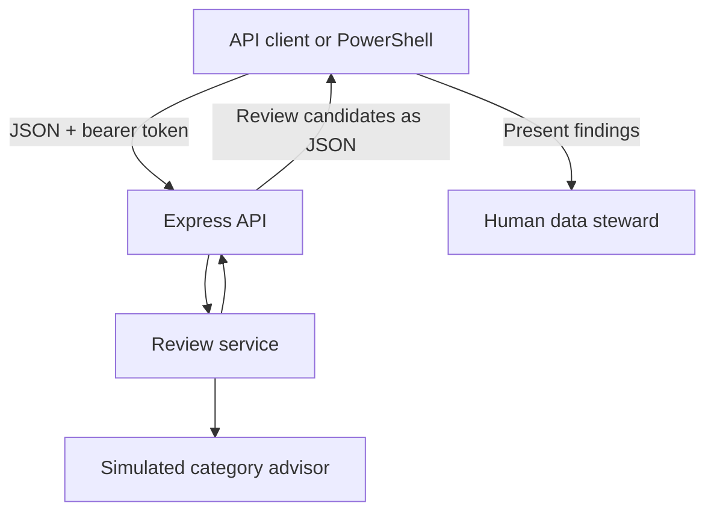
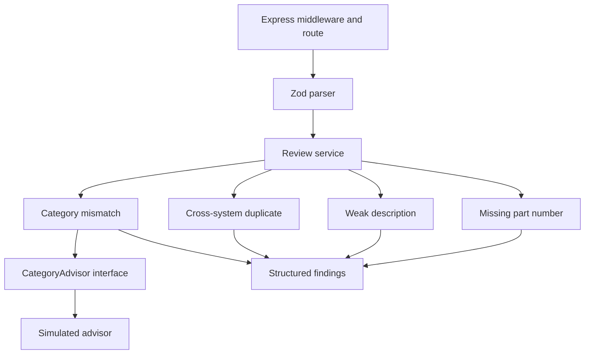
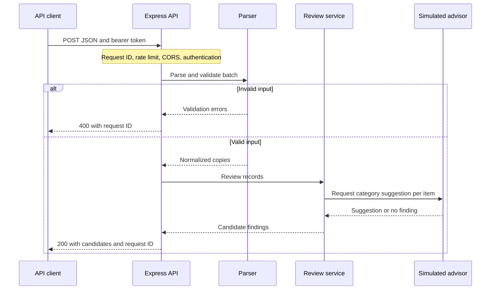

# Enterprise Data-Quality Assistant

An explainable, human-in-the-loop API that reviews item master data from multiple source systems and returns structured **review candidates** for a data steward.

**Assessment slice:** Node.js · TypeScript · Express · Zod · Vitest

> The service does not modify source records, approve findings, or write to production systems. Category analysis uses a simulated advisor; no external LLM is called.

## Contents

- [What the assistant does](#what-the-assistant-does)
- [Tech stack](#tech-stack)
- [High-level design](#high-level-design-hld)
- [Low-level design](#low-level-design-lld)
- [Request flow](#request-flow)
- [Quality checks](#quality-checks)
- [Quick start](#quick-start-windows-powershell)
- [Demo and results](#demo-and-results)
- [API contract](#api-contract)
- [Security and observability](#security-and-observability)
- [Testing](#testing)
- [Trade-offs and roadmap](#trade-offs-and-roadmap)

## What the assistant does

A user submits a JSON array of item records. The API validates the batch, evaluates four checks, and returns findings explaining what requires review, why it was flagged, and what a steward could do next.

The output is advisory. A returned `needs_review` status does not mean that a reviewer has approved a change. A review workflow and persistence are outside this slice.

## Tech stack

| Concern | Technology | Purpose |
|---|---|---|
| Runtime | Node.js 22+ | Server execution |
| Language | TypeScript 5+ | Strict typing and maintainable boundaries |
| HTTP | Express | Endpoint and middleware pipeline |
| Validation | Zod | Runtime input schema and sanitization |
| Configuration | dotenv and environment variables | Local configuration without committed secrets |
| Testing | Vitest | Unit and HTTP integration tests |
| Development | tsx | Run TypeScript during local development |

Install dependencies from the project's `package.json` and use its lockfile when available. Do not assume that the version in an older ZIP matches a later locally updated package.

## High-level design (HLD)



The API has no connection to an item-master database or external AI provider. Review and any subsequent action are performed outside this application.

## Low-level design (LLD)



| Component | Location | Responsibility |
|---|---|---|
| Entry point | `src/server.ts` | Load configuration and start the HTTP server |
| Configuration | `src/config.ts` | Validate environment configuration |
| HTTP layer | `src/app.ts` | Correlation ID, rate limit, CORS, authentication, JSON ingress and error handling |
| Parser | `src/parser.ts` | Validate the batch and create trimmed values |
| Review service | `src/service.ts` | Coordinate the four checks and aggregate findings |
| Rules | `src/rules/` | Generate deterministic, heuristic and simulated-advisor findings |
| Domain model | `src/model.ts` | Define item and finding types and construct review candidates |
| Tests | `tests/` | Unit tests and HTTP integration tests |

The project has no database layer because this assessment slice does not store or update records. The Express route is implemented in `app.ts`; it is not a separate controller or router.

## Request flow



The review service also runs missing-part and weak-description checks per item, then the cross-system duplicate check for the batch. Records are not persisted or modified in their source systems.

## Quality checks

| Check | Type | Implemented behavior | Limitation |
|---|---|---|---|
| Missing part number | Deterministic | Manufacturer present and part number missing after parsing | A finding is not proof of a source-data error. |
| Weak description | Heuristic | Missing description, fewer than 3 whitespace-separated words, or fewer than 12 characters | Short valid descriptions and non-English text may be flagged. |
| Possible duplicate | Heuristic | Both manufacturer and part number match after NFKC normalization, lowercasing and removing nonletters/numbers, across different normalized source systems | Potential false positives; no fuzzy matching or automatic merge. |
| Category mismatch | Simulated AI boundary | The simulator flags `bearing` or `valve` in a description when category is Electrical | Limited hardcoded examples; no real model or general classification. |

Confidence values are illustrative, uncalibrated scores—not measured probabilities. The `CategoryAdvisor` interface supports substitution with a mock; safe production LLM integration would also require controls described in [SPEC.md](SPEC.md).

## Quick start (Windows PowerShell)

**Prerequisites:** Node.js 22+ and npm. From the project root:

```powershell
cd E:\Assessment
npm install
Copy-Item .env.example .env
$token = node -e "console.log(require('node:crypto').randomBytes(32).toString('hex'))"
(Get-Content .env) -replace '^API_TOKEN=.*', "API_TOKEN=$token" | Set-Content .env
npm test
npm run build
npm start
```

Leave this terminal open. The server logs `SERVER_STARTED` and listens on the configured port, default `3000`. For development use `npm run dev`; the existing script does not watch for changes. If `.env` already contains your working configuration, **do not overwrite it** with `.env.example`.

Keep the token private. The example token is a placeholder and the application rejects it. Never commit `.env` or paste the token into public documentation.

### Configuration

| Variable | Example or default | Meaning |
|---|---|---|
| `PORT` | `3000` | HTTP port |
| `API_TOKEN` | Set a unique random secret, at least 32 characters | Shared bearer credential; required |
| `CORS_ORIGINS` | `http://localhost:5173` | Comma-separated exact origins allowed for browser requests |
| `RATE_LIMIT_WINDOW_MS` | `60000` | In-memory rate-limit window in milliseconds |
| `RATE_LIMIT_MAX` | `60` | Maximum requests per window per client IP |

## Demo and results

Open a second PowerShell window and submit the included sample:

```powershell
cd E:\Assessment
$token = (Get-Content .env | Where-Object { $_ -match '^API_TOKEN=' }) -replace '^API_TOKEN=', ''
$response = Invoke-RestMethod `
    -Method Post `
    -Uri 'http://localhost:3000/api/v1/review-candidates' `
    -Headers @{ Authorization = "Bearer $token" } `
    -ContentType 'application/json' `
    -InFile '.\examples\items.json'
```

Show the actual findings as a table:

```powershell
$response.candidates |
    Select-Object item_id, source_system, issue_type, explanation, suggested_action, source |
    Format-Table -Wrap -AutoSize
```

Show the complete response, including confidence and related records:

```powershell
$response | ConvertTo-Json -Depth 10
```

The included sample generates five candidate rows:

| Item | Candidate issue | Explanation | Detection source |
|---|---|---|---|
| 1001 | Missing part number | Manufacturer is present, but the part number is blank. | Deterministic rule |
| 1001 | Weak description | `bearing` may lack identifying attributes. | Heuristic |
| 1002 | Category mismatch | A bearing is categorized as Electrical. | Simulated AI |
| 1002 | Possible duplicate | The normalized manufacturer and part number match item 1003 in another system. | Heuristic |
| 1003 | Possible duplicate | The same pair is presented from item 1003's perspective. | Heuristic |

To demonstrate different inputs, create another JSON file and change `-InFile` to its path. The output is computed from the submitted records. This project currently has **no browser UI**; the table above is documentation and the PowerShell table renders actual API results.

## API contract

`POST /api/v1/review-candidates`

Headers: `Authorization: Bearer <token>` and `Content-Type: application/json`.

```json
[
  {
    "item_id": "1001",
    "item_description": "bearing",
    "manufacturer": "SKF",
    "manufacturer_part_number": "",
    "category": "Mechanical",
    "unit_of_measure": "EA",
    "source_system": "ERP-A"
  }
]
```

`item_id` and `source_system` are required nonblank strings, up to 100 characters. Other supported fields may be omitted, null or strings up to 500 characters; blank optional strings are normalized to null in a parsed copy. Unknown fields and invalid types are rejected. Input must contain 1–500 rows, with a maximum request body of 256 KB. Any invalid row rejects the batch with validation details.

Example candidate, abbreviated from the response:

```json
{
  "item_id": "1001",
  "source_system": "ERP-A",
  "status": "needs_review",
  "issue_type": "missing_part_number",
  "severity": "medium",
  "confidence": 1,
  "explanation": "Manufacturer is present but manufacturer part number is missing.",
  "suggested_action": "Request the part number from the source owner and review it.",
  "source": "deterministic_rule"
}
```

The response also includes `record_count`, `candidates`, and `request_id`; duplicate findings contain `related_items`.

| HTTP status | Meaning |
|---|---|
| 200 | Candidates generated; an empty list means no checks matched. |
| 400 | Invalid JSON or input validation failed. |
| 401 | Missing or invalid bearer token. |
| 403 | Browser origin not on the allowlist. |
| 404 | Route not found. |
| 413 | Request body too large. |
| 415 | Unsupported content type. |
| 429 | Per-process rate limit exceeded. |
| 500 | Internal or advisor failure. |
| 503 | In-memory rate-limit capacity reached. |

## Security and observability

- **Authentication:** a configured shared bearer secret protects the review endpoint; this is coarse access control, not per-user identity or role-based authorization.
- **CORS:** browser origins are checked against an exact allowlist. CORS does not authenticate clients.
- **Rate limiting:** in-memory, per-process IP windows and bounded entry count. Instances do not share counters; state resets on restart. `trust proxy` is disabled.
- **Input:** authenticated JSON input is bounded and validated before review. Client data is untrusted.
- **Logging:** JSON request/error logs include timestamps, levels, codes and a generated request ID. Tokens and request bodies are not logged. Logs are not an audit trail.
- **Production controls:** use TLS, an identity provider and scoped authorization, gateway/distributed rate limiting, secret management and deployment-specific proxy configuration before production use.

## Testing

```powershell
npm test
npm run build
```

The suite covers individual rule behavior, validation and configuration, as well as HTTP authentication, rate limiting, origins, invalid JSON, payload limits and a valid review request. Tests use an injected advisor for isolation. Run both commands against your current dependency lockfile; test results may change when dependencies are upgraded.

## Trade-offs and roadmap

**Implemented:** four explainable checks, JSON ingestion, input limits, structured candidates, bearer authentication, in-memory limiting, correlated logs and automated tests.

**Not implemented:** user-facing browser UI, database, approval or rejection workflow, persistent audit history, real LLM, calibrated confidence, distributed limits and granular user permissions. Item ID and source system together are not guaranteed unique; a persistent workflow should introduce a stable row identifier.

**Next steps:** add a review interface and audit trail, integrate identity and scoped authorization, measure heuristic quality against labeled data, and evaluate a privacy-reviewed AI advisor with output validation, timeouts and human oversight. See [SPEC.md](SPEC.md) for assumptions, safeguards and further detail.

## Assessment discussion

Explain what you delegated to an AI coding tool, what you personally inspected and tested, why the checks produce candidates rather than corrections, and which trade-offs you would address with more time. Report your own actual verification results rather than assuming another environment produced identical results.
